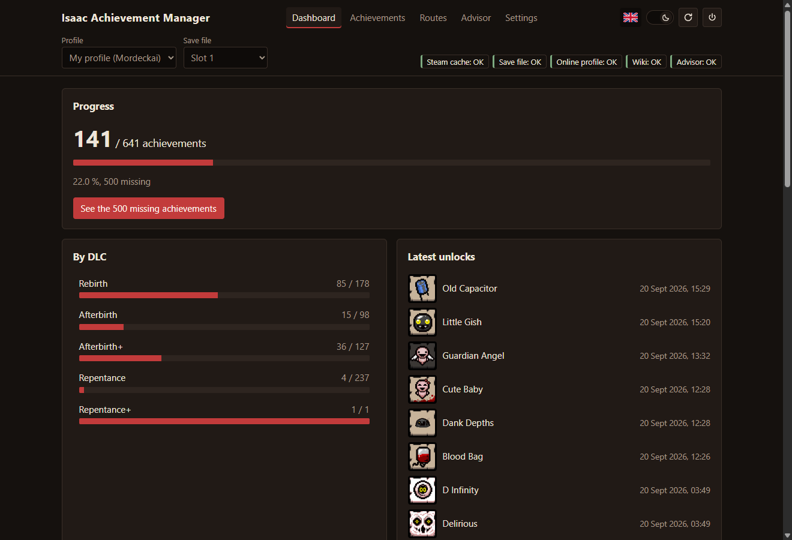
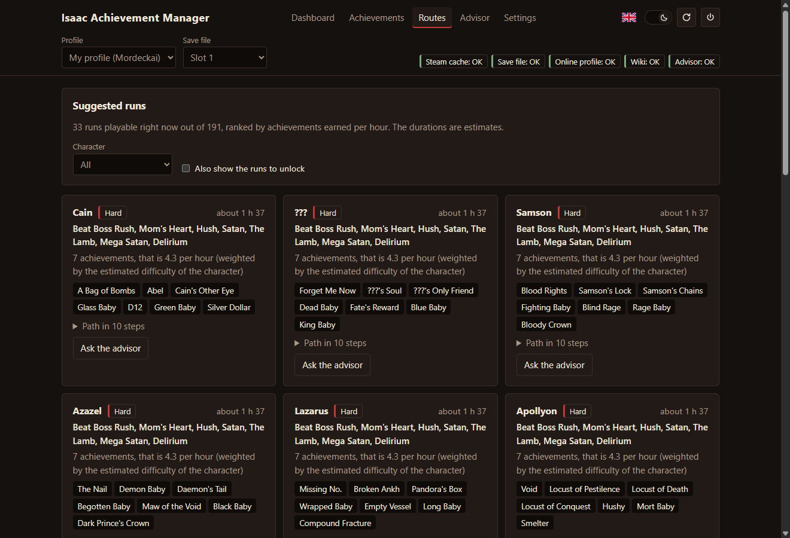
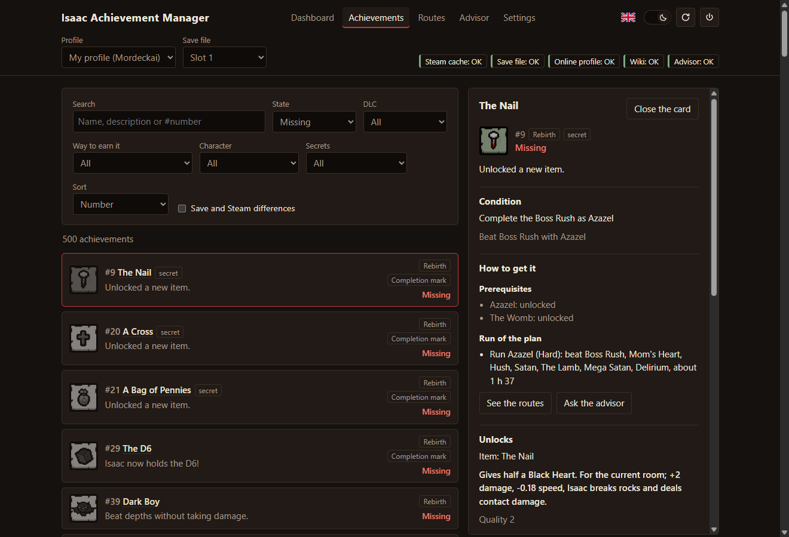
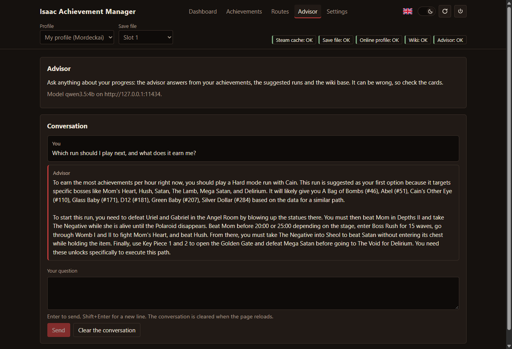
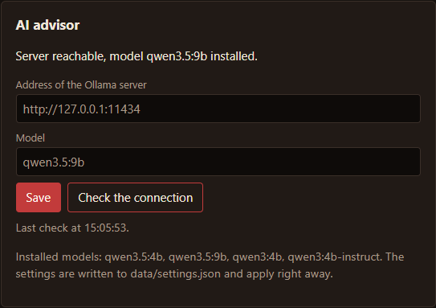
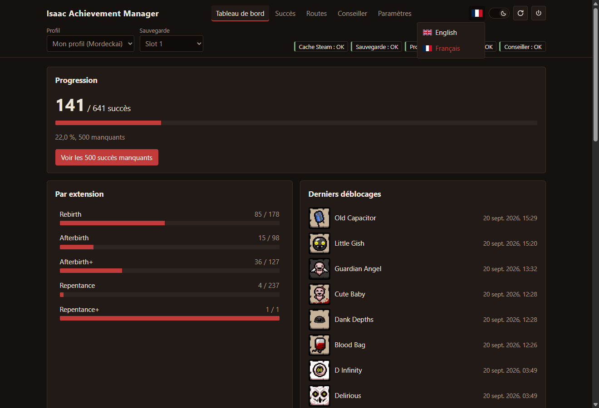

# Isaac Achievement Manager

A local web app that reads your progress in [**The Binding of Isaac: Rebirth**](https://store.steampowered.com/app/250900/)
(Repentance+, Steam appid `250900`) and tells you what is left to unlock: which runs to play, in which
order, and what each achievement asks for. Everything stays on your machine, in English or in French.



## The game

[**The Binding of Isaac: Rebirth** on Steam](https://store.steampowered.com/app/250900/), by
**Edmund McMillen** and **Nicalis**. This is a fan-made companion tool: it reads the game files, it
never writes to them.

## Compatibility

| | |
|---|---|
| Game | Repentance+, Windows, launched at least once |
| Reads | Steam achievement cache, `rep+persistentgamedata{1,2,3}.dat`, public Steam profile |
| Requirements | Windows 10 or 11, Node.js 26 or newer, Steam |
| Advisor (optional) | an [Ollama](https://ollama.com/) server, which the app can install for you |

Your Steam profile needs its game details set to public for the cross check and for looking up
another player. Everything else works offline once the wiki base is downloaded.

## Run

Double click **`Isaac Manager.cmd`**. It installs what is missing (Node.js through winget, the npm
dependencies, the interface build), starts the server and opens <http://127.0.0.1:5250/>. The first
start takes a minute, the next ones are immediate. Everything it prints also goes to
`data/server.log`.

From a terminal instead:

```
npm install
npm run build
npm start
```

To stop it: the power button in the header, or `npm run stop`.

### Standalone executable

`npm run build:exe` packs Node, the server and the interface into one file,
`dist/Isaac Achievement Manager.exe` (about 100 MB). It needs nothing installed: double click it, it
starts the server, opens your browser on the app and keeps its `data/` folder next to itself, so it
works on its own in any folder it can write to. `--with-kb` copies the wiki base along with it, so
the first launch is already complete.

It runs in the background, with no window. Closing the tab leaves it running: starting the
executable again opens the page of the running copy, and the power button in the header stops it.
What it prints goes to `data/server.log`; an error that stops it, such as a port already taken,
also shows in a message box.

Windows shows a SmartScreen warning the first time, because the file is not signed.

### Updates

The app reads the latest [release](https://github.com/JustMordeckai/isaac-achievement-manager/releases)
when it starts. When a newer one is out, a line appears above the pages: one button downloads the new
executable next to the running one, checks it against the `SHA256SUMS.txt` of the release and puts it
in place, a second one restarts the app on it. Nothing to download by hand, nothing to reinstall, and
the `data/` folder stays where it is.

Windows keeps a running executable locked against writes, so the old file is renamed to
`... .exe.old` rather than deleted; the next start drops it. If the download or the checksum fails,
nothing is replaced and the line says why.

A copy running from its sources says so instead: `git pull`, then start it again. The settings screen
shows the version in use and checks again on demand.

On the first launch the wiki base does not exist yet: a banner says so and leads to the settings,
whose **Sync the wiki** button downloads it (about 600 pages, around twenty seconds). The same sync
exists on the command line: `npm run sync-wiki`. It never runs on its own, so start it again after a
game or wiki update.

## Use

### Dashboard

Overall progress and progress per DLC, the latest unlocks, the three best runs to play, and the grid
of completion marks of the 34 characters. The header badges say whether each source is readable and
whether the save, Steam and the online profile agree.

### Routes



Runs to play, per character: endings to beat, path step by step, achievements earned, prerequisites,
ranked by achievements per hour. The mode is hard until the "every mark on hard" achievement of the
character is earned. By default only the runs you can play right now are listed; one checkbox adds
the others with what to unlock first. Below the runs: the achievements no run can bring (challenges,
counters, the closets of Home, miscellaneous), with the counters read from your save.

Durations and character difficulty factors are manual estimates, not measurements.

### Achievements



The 641 achievements, filtered by state, DLC, way to earn them, character, secrets, search or
differences between sources. The card of each one is built from the English wiki: condition, what it
unlocks, tips, links to the source pages, and for a missing one its prerequisites and the runs of the
plan that earn it.

### Advisor



Free questions to an Ollama model. It answers from your progress (achievements, completion marks,
first ten suggested runs) and up to twenty achievement cards chosen from the names in your question:
achievements, numbers such as `#45`, characters, bosses, items. The answer arrives as it is written,
the cards sent to the model are listed under it, and each one opens.

The model is told to answer from those data only, but a small model can still get it wrong: check in
the cards. The conversation lives as long as the page stays open, and only the last five exchanges
are sent back.

### Settings



Interface language, wiki sync with its progress, Ollama server and model (the list offers the models
installed on the server), and the Steam paths and account that were detected. Saving writes
`data/settings.json` and applies without a restart.

As long as the advisor cannot answer, this screen offers to set it up: it says whether Ollama is on
the machine and installs it with winget if it is not, reads the video memory to pick the model the
machine can run, downloads it with its progress, and puts it to use once it is there. The whole
advisor stays optional: skip it and the rest of the app works the same.

## Language



English or French, picked from the flag in the header, which opens the list of languages. The choice
is saved in `data/settings.json` and in the browser, so it survives a reload and a restart. The advisor answers
in the language of the interface. The names of the game (achievements, characters, items, bosses)
stay in English in both, because that is what the game shows.

## Settings file

Optional file `data/settings.json`:

```json
{
  "port": 5250,
  "accountId": null,
  "locale": "en",
  "ollama": { "url": "http://127.0.0.1:11434", "model": "qwen3.5:4b" }
}
```

- `port`: local listening port.
- `accountId`: Steam account id to use (otherwise the account logged into Steam when it has Isaac
  data, then the last logged account that has some).
- `locale`: `en` or `fr`, written by the flags.
- `ollama`: address of the Ollama server and model of the advisor, both editable from the settings.

`port` and `accountId` need an edit of this file and a restart. An unreadable file is never
overwritten: saving from the interface is then refused.

## Safety

- The app listens on `127.0.0.1` only. Nothing leaves the machine except the wiki sync, the public
  Steam profile it is asked for, the questions you send to your own Ollama server, and the version of
  the latest release read from the GitHub API at startup.
- Steam and game files are only ever read. The app writes inside `data/` and nowhere else: cached
  icons, wiki base (`kb.json`), copy of the wiki pages (`wiki-cache/`), log, settings.
- No account, no telemetry, no cloud.

## Troubleshooting

If double clicking `Isaac Manager.cmd` does nothing, read `data/server.log`, check `node --version`
(26 or newer), and run `npm start` in a terminal to see the error directly.

If the wiki sync fails, the previous base stays in use. With no network, the sync reuses the pages
already copied in `data/wiki-cache/`; the report says how many.

If the advisor does not answer: the settings screen offers to install Ollama and to download a model
for you. For a server on another machine, check its address there (**Check the connection**), that
the model is installed (`ollama pull qwen3.5:4b`), and that its firewall lets the port 11434 through.
The rest of the app works without Ollama.

If the answers never arrive although the server responds: Ollama handles one request at a time per
model, so another application keeping it busy makes yours wait. Video memory matters too: the app
asks for a 32768 token context, which has to fit next to the model. `curl
http://127.0.0.1:11434/api/ps` on the server shows what is loaded.

## What it reads

| Source | Location |
|---|---|
| Achievement schema | `Steam/appcache/stats/UserGameStatsSchema_250900.bin` |
| Local Steam achievements | `Steam/appcache/stats/UserGameStats_<account>_250900.bin` |
| Save file (secrets, counters, completion marks) | `Steam/userdata/<account>/250900/remote/rep+persistentgamedata{1,2,3}.dat` |
| Public profile | `https://steamcommunity.com/profiles/<SteamID64>/stats/250900/?xml=1` |
| Wiki (manual sync) | `https://bindingofisaacrebirth.fandom.com/api.php` |
| Advisor | an Ollama server (`/api/tags`, `/api/chat`) |

The save slot shown by default is the most recently modified one; a picker changes it.

## Development

```
npm run dev        # server plus Vite (hot reload) on http://127.0.0.1:5250/
npm test           # 676 Vitest tests (server and front)
npm run typecheck  # TypeScript
npm run sync-wiki  # wiki sync with no interface
npm run build:exe  # dist/Isaac Achievement Manager.exe, Node included
node scripts/check-language.mjs  # fails when French leaks outside shared/i18n/fr.ts
```

The interface texts live in `shared/i18n/en.ts` and `shared/i18n/fr.ts`, one key per string, read by
both the server and the front. A new string goes into both catalogues.

A release is the version in `package.json` and in `shared/version.ts` (a test keeps them equal), then
`npm run build:exe`, then a GitHub release tagged `vX.Y.Z` carrying the executable and a
`SHA256SUMS.txt`. That is what the running apps look at.

The files under `tests/fixtures/` are real game files (achievement schema, Steam cache, save, wiki
pages) with the Steam identity replaced by a fictional account: id `123456789`, SteamID64
`76561198083722517`, nickname `Player`.

## Notes

MIT, see [LICENSE](LICENSE). Unofficial fan tool, no affiliation with Nicalis or Edmund McMillen;
*The Binding of Isaac*, the names of the game and the icon of the app, taken from the game itself,
belong to them. The card contents come from the
[The Binding of Isaac: Rebirth wiki](https://bindingofisaacrebirth.fandom.com/) (Fandom) under
CC BY-SA, and every card links to its source pages. [Ollama](https://ollama.com/) and the models you
run on it keep their own licences.
